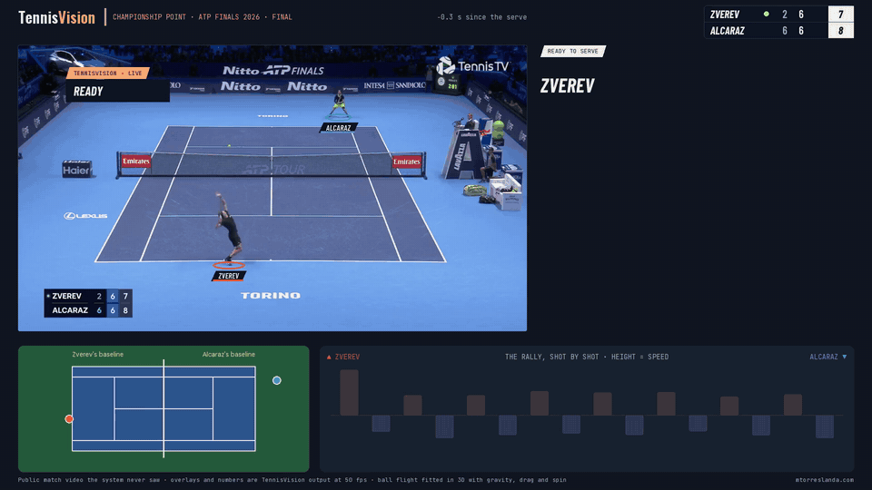
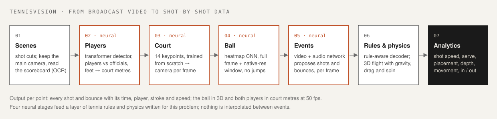
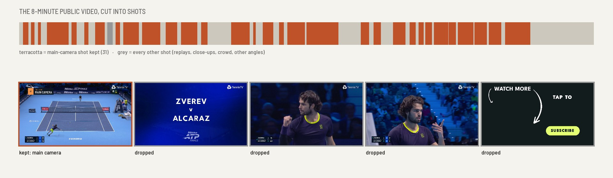
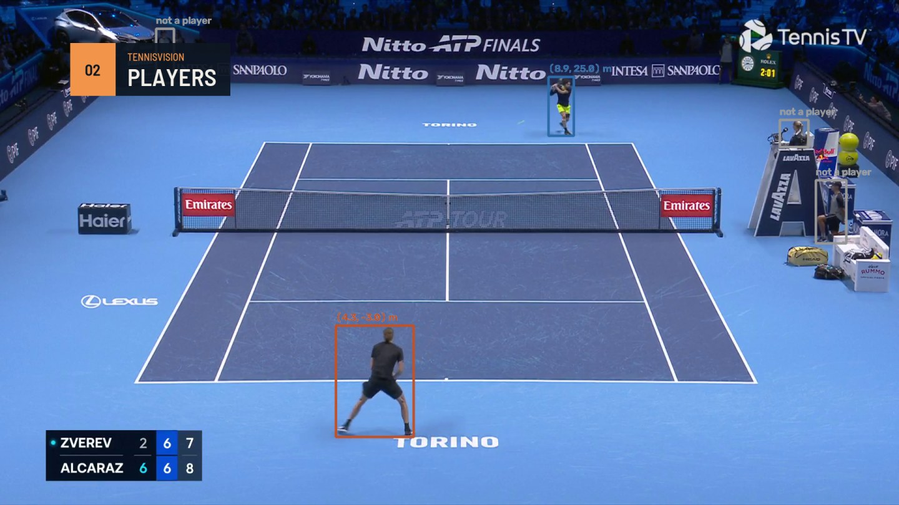
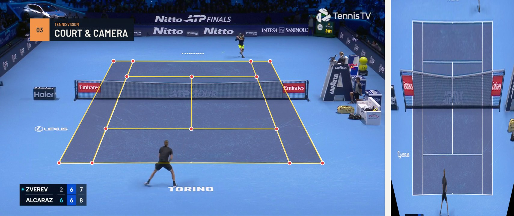
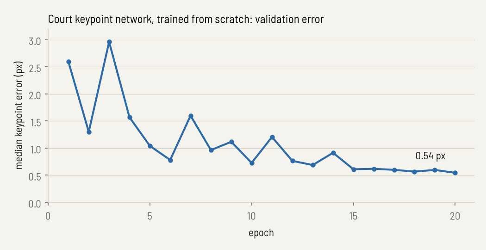
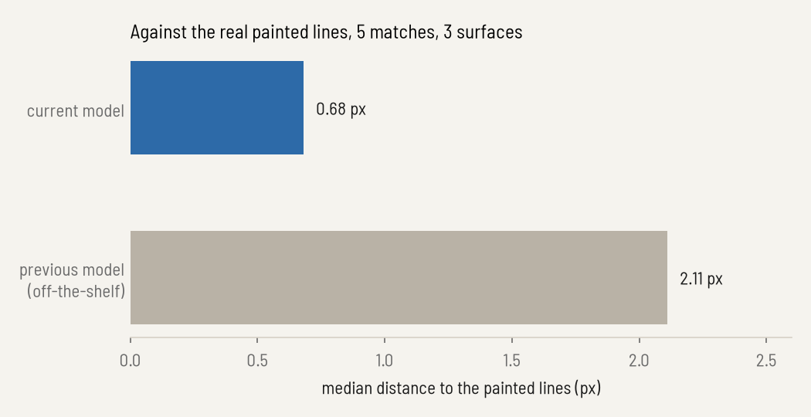
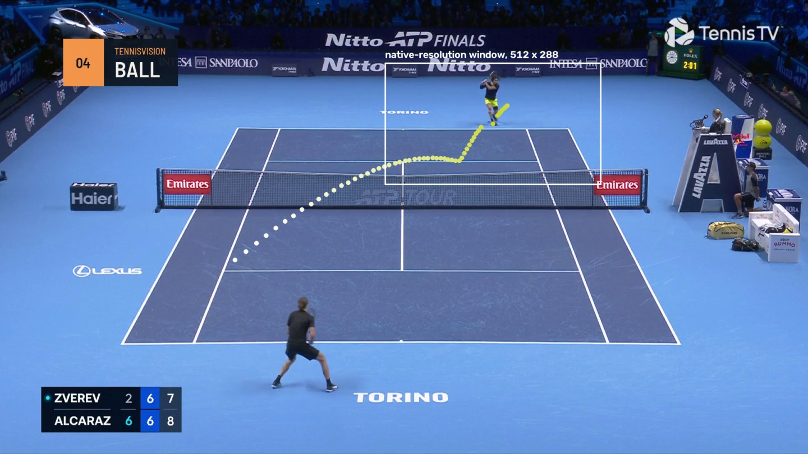
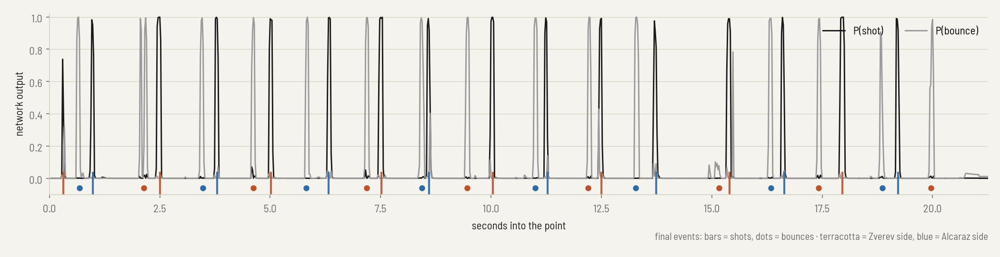
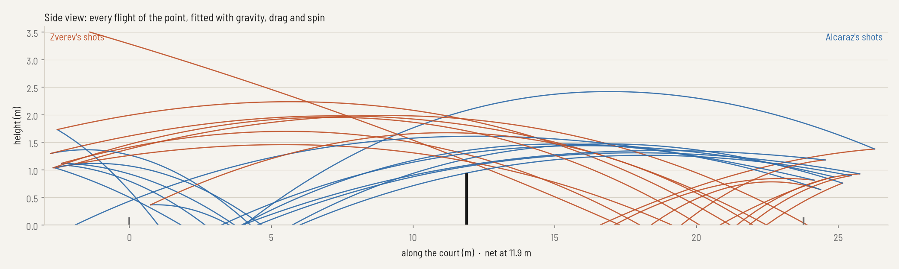

# TennisVision

**From a single broadcast feed to shot-by-shot tennis data: every shot, every bounce, the ball in 3D.**

TennisVision watches ordinary TV coverage of a tennis match and turns every point into data: when each shot is hit, by whom, with which stroke and how fast; where each bounce lands and whether it is in; the ball's flight in three dimensions; and both players' positions in court metres, 50 times per second. Everything shown here was produced by the pipeline on a **public video it had never seen**: the championship point of the 2026 ATP Finals, Alcaraz vs Zverev.

Second-set tie-break, Zverev serving at 7–8. Left: the broadcast with overlays re-projected from our tracks and the fitted 3D ball flight. Right: the card of the shot in play. Bottom: the point from above and the rally, shot by shot. [Full-resolution video (MP4)](media/live-board.mp4).

**The data behind it:** [tracking at 50 Hz](data/championship-point-tracking.csv) (ball in 3D, both players in court metres) · [every shot and bounce](data/championship-point-events.csv) (player, stroke, speed, bounce position, in / out).

---

## What the live board shows

Shot-level tennis data usually comes from multi-camera systems installed at a handful of venues. Everything on the board is computed from one broadcast camera:

| Element | What it shows | On this point |
|---|---|---|
| **Shot card** | Player and stroke; launch speed against the rally average; where the ball bounced and the in / out call; contact height; clearance over the net; time from shot to bounce; where the player hit from | The winner: Alcaraz's backhand at 120 km/h, 0.17 m over the net, in, 4.0 m from the baseline |
| **Rally strip** | One bar per shot, Zverev up and Alcaraz down; height = launch speed | 16 shots, from a 240 km/h serve to groundstrokes between 84 and 128 km/h |
| **Top-down court** | Every bounce, numbered by the shot that produced it and coloured by hitter; both players' paths; the ball's current flight | All of Alcaraz's shots land between 3.3 and 6.0 m from Zverev's baseline; 7 of Zverev's 8 land on the same side of the centre line |
| **On the video** | Each player at their feet, the 3D ball with its shadow, a ring on every bounce | — |

In / out follows the rule of the game: a ball that touches the line is in. Movement data (distance and speed of each player) is in the [tracking file](data/championship-point-tracking.csv).

---

## Architecture

Seven stages. Each one is measured on its own, so an improvement in one stage cannot hide a loss in another.

### 1 · Scenes

A broadcast is mostly not the main camera: replays, close-ups, crowd shots, graphics. The video is cut into shots. A shot is kept only if the court seen from the main camera is found in it, and the scoreboard is read with OCR (server, score).

The 8-minute public video, cut automatically: the main-camera shots that carry the points (terracotta) and everything else (grey).

### 2 · Players

A transformer object detector finds every person in the frame; a filter keeps the two players and drops the umpire, line judges and ball kids. The feet of each player are projected onto the court, in metres.

One frame before the serve: the two players with their court position in metres; everyone else, discarded.

### 3 · Court and camera

To turn pixels into metres, every frame needs to know where the court is. A **keypoint network, trained from scratch,** finds the 14 intersections of the painted lines. From them, a homography per frame for the ground, and a full 3D camera that pans and zooms like a TV camera does.

Left: the 14 keypoints and the court lines they imply, on the broadcast frame. Right: the same frame warped to a top-down view with that homography.

**Training**

| | |
|---|---|
| Model | keypoint network, randomly initialised (no pre-trained weights) |
| Data | 4,950 labelled frames from 5 matches and 3 surfaces (hard, clay, grass) |
| Split | validation on scenes held out from training (740 frames, 61 scenes) |
| Schedule | 20 epochs, ≈ 1.5 h on a single consumer GPU (AMD Radeon RX 9070 XT, ROCm) |
| Validation | median keypoint error 2.59 px after the first epoch → **0.54 px** |

Against the real painted lines, across 5 matches and 3 surfaces, it is three times more precise than the off-the-shelf model it replaced: **0.68 px** against 2.11 px.

### 4 · Ball

The ball is a few pixels wide, blurred, and often hidden. Two convolutional heatmap networks work together: one scans the whole frame; the second re-examines a window of the frame **at native resolution** around the ball's predicted path, where the ball is sharpest. A last pass removes physically impossible jumps.

Two seconds of the rally, one dot per detection, and the native-resolution window that follows the ball.

### 5 · Events

A video network that **fuses image and sound** — the crack of the racket, the thud of the bounce — looks at short windows around the ball and outputs, for every frame, the probability of a shot and of a bounce.

The network's output over the whole point, and the final events after the next stage: one bar per shot, one dot per bounce.

### 6 · Rules and physics

Raw probabilities are not tennis. A **decoder that knows the rules** (serve, bounce, shot, bounce…, a shot needs a player near the ball) turns them into a clean sequence of events and adds the bounces the network missed between two shots. On 439 hand-reviewed points this layer cut errors from 195 to 144.

Then **physics instead of interpolation**: the ball between two events is a 3D flight fitted to the detections, with gravity, air drag and spin, through the moving TV camera. Shot speeds, heights and bounce positions come from these flights; drag was calibrated against the official radar.

Side view of every flight of the championship point. All 31 flights were accepted by the fit's quality check, with a median reprojection error of 1.5 px.

---

## Results

Measured on matches reviewed by hand, shot by shot: 439 points and 3,199 shots and bounces, from four matches on hard, clay and grass.

| What | Metric | Result |
|---|---|---|
| Events | real shots and bounces detected | **96 %** of 3,199 |
| Serve | serves found | **99.5 %** |
| Points | points read without a single error, on matches never used to tune the system | **97 %** (clay and grass included) |
| Rules layer | errors on 439 points, before → after the rule-aware decoder | 195 → **144** |
| Court | median distance to the painted lines | **0.68 px** (off-the-shelf model: 2.11 px) |
| Serve speed | median error against the official radar display | **9.5 km/h** |

What is still hard: a bounce that happens right next to a shot (the sharp change of direction looks the same), the ball hidden behind the near player at the moment it bounces, and any camera other than the main one.

---

## Amateur version · in progress

A second line of work adapts TennisVision to **club tennis filmed with a single fixed camera and no scoreboard**: the goal is the score, the stats and the highlights of the match, built automatically.

What already works, on a full set with hand-checked truth: rallies are cut by detecting the serving pose (**56 of 57 serves** found, and who serves right in all of them), and the score is rebuilt from the structure of the match: given who wins each point, **38 of 38 points and the 6–0 set** come out right. Next: telling who wins each point from the video alone.

---

## The data

Full pipeline output for the championship point, in court metres: `x` across the court (0–10.97, doubles sidelines), `y` along it (0–23.77, from Zverev's baseline to Alcaraz's).

[`data/championship-point-events.csv`](data/championship-point-events.csv): the 32 events of the point.

| Column | Meaning |
|---|---|
| `time_s` | seconds from the serve |
| `event` | `shot` or `bounce` |
| `player` | for a shot, who hit it; for a bounce, who hit the ball that bounced |
| `stroke` | serve, forehand or backhand |
| `speed_kmh` | launch speed of the shot, from the fitted 3D flight |
| `x_m`, `y_m` | where the ball bounced |
| `call` | in / out (a ball touching the line is in) |

[`data/championship-point-tracking.csv`](data/championship-point-tracking.csv): 50 rows per second.

| Column | Meaning |
|---|---|
| `time_s` | seconds from the serve (from −0.3 s, before the serve, to the end of the point) |
| `ball_x_m`, `ball_y_m`, `ball_z_m` | the ball in 3D (`z` = height); empty where no flight was fitted |
| `zverev_x_m`, `zverev_y_m`, `alcaraz_x_m`, `alcaraz_y_m` | each player's position on the court |

It is pipeline output on a video with no ground truth, shared to show the format and the level of detail — not a reference dataset.

---

## Stack

Python · PyTorch · OpenCV · NumPy / SciPy · pandas · ONNX Runtime (OCR) · AMD ROCm. Only permissively licensed components (Apache 2.0, MIT, BSD).

## About this repository

This is a showcase: it documents what TennisVision does and how well it does it. The source code, training data and model weights are not published.

Match footage belongs to the ATP and its broadcaster; the frames and the 21-second clip shown here come from a [public YouTube upload](https://www.youtube.com/watch?v=YiWjCKWBWog) and are used, small and short, for illustration only. Everything drawn on top of them is TennisVision output.

© 2026 Miguel A. Castro · [mtorreslanda.com](https://mtorreslanda.com)
